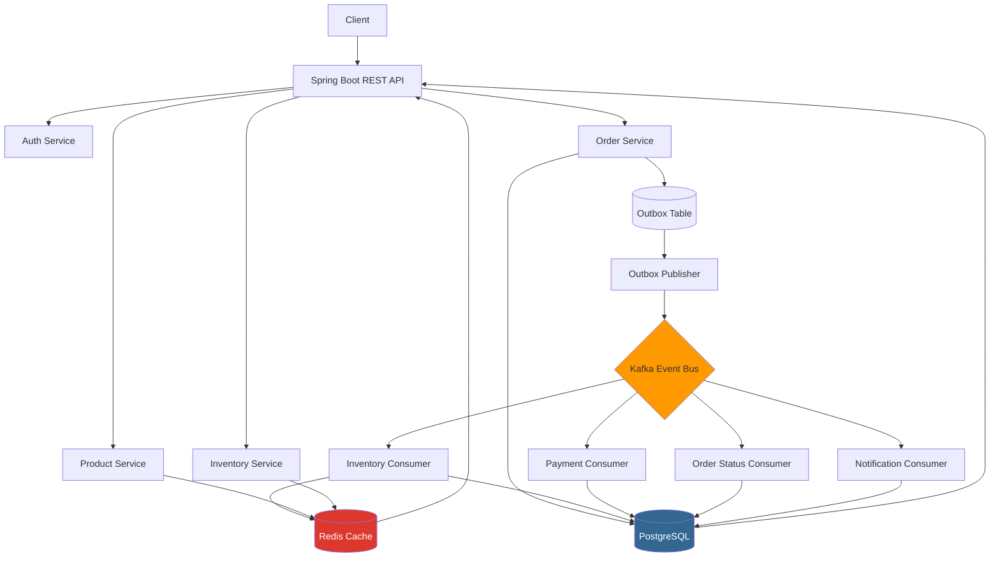
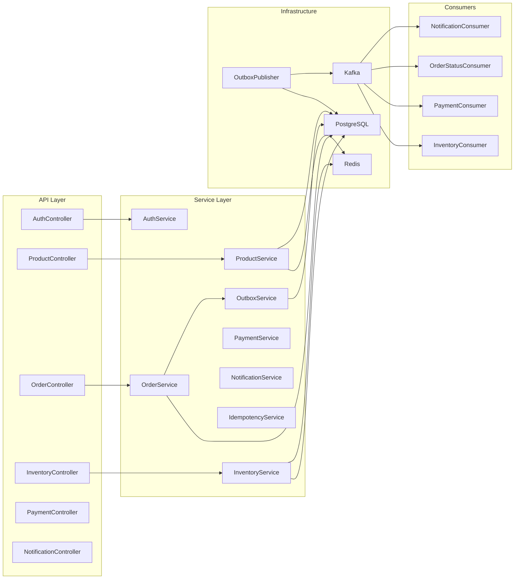

# High-Scale Event & Order Processing System

A production-grade, event-driven order processing platform built with Java 21, Spring Boot 3.x, PostgreSQL, Apache Kafka, Redis, and Docker. Designed to demonstrate strong backend engineering, distributed systems concepts, and scalability patterns.

[](https://openjdk.java.net/)
[](https://spring.io/projects/spring-boot)
[](https://kafka.apache.org/)
[](https://www.postgresql.org/)
[](https://redis.io/)
[](https://opensource.org/licenses/MIT)

## Overview

This system implements a complete e-commerce order processing flow with event-driven architecture:

1. User registers/logs in (JWT)
2. Browses products (cached)
3. Creates order (transactional)
4. Order stored in PostgreSQL + event saved to outbox
5. Outbox publisher publishes `OrderCreated` to Kafka
6. Inventory consumer reserves stock (atomic, prevents overselling)
7. Payment consumer simulates payment (5% random failure)
8. Order status updated through state machine
9. Notification consumer creates user notifications
10. Client queries order status

**Key Features:**
- Transactional Outbox Pattern for reliable event publishing
- At-least-once delivery with idempotent consumers ⇒ effectively-once *business effects* (see "Delivery guarantees" in `docs/engineering-audit.md`)
- Retry with exponential backoff (1s → 2s → 4s, max 3) + dead-letter topics (`<topic>.DLT`) and a `failed_events` inspection table
- Redis caching with fallback
- Concurrency-safe stock via atomic conditional `UPDATE` (+ `@Version` on entities); no lock is held across requests
- JWT authentication with RBAC
- Comprehensive observability (Actuator, Prometheus, correlation IDs)

## Features

- ✅ User registration/login with JWT
- ✅ Role-based access (USER, ADMIN)
- ✅ Product CRUD with caching
- ✅ Inventory management with overselling prevention
- ✅ Order creation with validation
- ✅ Event-driven processing via Kafka
- ✅ Simulated payment with failure injection
- ✅ Notifications
- ✅ Outbox pattern
- ✅ Idempotency
- ✅ Retry + DLQ
- ✅ Redis caching
- ✅ Concurrency handling
- ✅ Centralized error handling
- ✅ OpenAPI/Swagger docs
- ✅ Actuator health & metrics
- ✅ Docker Compose full stack
- ✅ Unit + integration + concurrency tests
- ✅ Performance testing harness

## Architecture

### High-Level Flow



### Component Diagram



## Technology Stack

| Layer | Technology | Version | Purpose |
|-------|------------|---------|---------|
| Language | Java | 21 | Main language |
| Framework | Spring Boot | 3.2.6 | Application framework |
| Security | Spring Security + JWT (JJWT) | 0.12.6 | Auth & authz |
| Database | PostgreSQL | 15 | Primary data store |
| Migration | Flyway | 10.x | DB migrations |
| Cache | Redis + Spring Cache | 7 | Caching |
| Messaging | Apache Kafka (KRaft) | 3.8.0 | Event bus |
| ORM | Spring Data JPA + Hibernate | 6.x | Data access |
| API Docs | SpringDoc OpenAPI | 2.6.0 | Swagger |
| Observability | Actuator + Micrometer + Prometheus | - | Metrics & health |
| Build | Maven | 3.9.x | Build tool |
| Testing | JUnit 5, Mockito, Testcontainers | - | Testing |
| Container | Docker & Docker Compose | - | Deployment |
| Mapping | MapStruct | 1.5.5 | DTO mapping |

## System Flow

### Successful Order

```
1. POST /api/orders {productId: 1, quantity: 2}
2. OrderService validates product, calculates total
3. BEGIN TRANSACTION
   - INSERT INTO orders (status=CREATED)
   - INSERT INTO order_items
   - INSERT INTO outbox_events (OrderCreated, PENDING)
   COMMIT
4. OutboxPublisher (every 5s) publishes to order.created topic
5. InventoryConsumer receives OrderCreated:
   - Checks idempotency_records (duplicate?)
   - Atomic UPDATE inventory SET available = available - qty WHERE available >= qty
   - If success: UPDATE orders SET status=INVENTORY_RESERVED → PAYMENT_PENDING
   - Publishes inventory.reserved
   - If fail: publishes inventory.failed, marks order FAILED
6. PaymentConsumer receives inventory.reserved:
   - Idempotency check
   - Simulates payment (5% failure)
   - If success: order → PAYMENT_COMPLETED → PROCESSING
   - Publishes payment.processed
   - If fail: releases inventory, order → PAYMENT_FAILED → FAILED, publishes payment.failed
7. OrderStatusConsumer receives payment.processed:
   - Confirms inventory reservation (reserved → deducted)
   - Order → COMPLETED
   - Publishes order.completed
8. NotificationConsumer receives order.completed:
   - Creates notification for user
9. Client GET /api/orders/{id} → COMPLETED
```

### Failure Scenarios

- **Insufficient inventory:** Order → INVENTORY_FAILED → FAILED + notification
- **Payment failure:** Release inventory, order → FAILED + notification
- **Kafka down:** Outbox retains PENDING, publisher retries
- **Redis down:** Fallback to DB, logs warning
- **Duplicate event:** Idempotency check skips

## Database Design

### ER Diagram

```mermaid
erDiagram
    USERS ||--o{ ORDERS : places
    PRODUCTS ||--o{ INVENTORY : has
    ORDERS ||--o{ ORDER_ITEMS : contains
    PRODUCTS ||--o{ ORDER_ITEMS : referenced
    ORDERS ||--o{ PAYMENTS : has
    USERS ||--o{ NOTIFICATIONS : receives
    ORDERS ||--o{ NOTIFICATIONS : generates

    USERS {
        bigint id PK
        varchar username UK
        varchar email UK
        varchar password
        boolean enabled
    }
    PRODUCTS {
        bigint id PK
        varchar name
        numeric price
        varchar category
        boolean active
    }
    INVENTORY {
        bigint id PK
        bigint product_id FK UK
        int available
        int reserved
    }
    ORDERS {
        bigint id PK
        varchar order_number UK
        bigint user_id FK
        varchar status
        numeric total
    }
    ORDER_ITEMS {
        bigint id PK
        bigint order_id FK
        bigint product_id FK
        int quantity
        numeric unit_price
    }
    PAYMENTS {
        bigint id PK
        bigint order_id FK UK
        varchar status
        numeric amount
    }
```

### Key Tables

- **users, roles, user_roles:** Authentication
- **products, inventory:** Catalog
- **orders, order_items:** Orders
- **payments:** Payment tracking
- **notifications:** User notifications
- **outbox_events:** Transactional outbox
- **idempotency_records:** Idempotency
- **failed_events:** DLQ

Full schema: `src/main/resources/db/migration/V1__init_schema.sql`

## Kafka Event Architecture

### Topics

| Topic | Partitions | Description |
|-------|------------|-------------|
| order.created | 3 | Order creation |
| inventory.reserved | 3 | Inventory success |
| inventory.failed | 3 | Inventory failure |
| payment.processed | 3 | Payment success |
| payment.failed | 3 | Payment failure |
| order.completed | 3 | Order completion |
| *.DLT | 1 | Dead Letter |

### Event Schemas

**OrderCreatedEvent:**
```json
{
  "eventId": "uuid",
  "correlationId": "uuid",
  "timestamp": "2026-01-01T00:00:00Z",
  "eventType": "OrderCreated",
  "orderId": 123,
  "orderNumber": "ORD-123",
  "userId": 456,
  "totalAmount": 199.99,
  "items": [{"productId": 1, "quantity": 2, "unitPrice": 99.99}]
}
```

See `docs/kafka-events.md` for all schemas.

## Redis Strategy

**What cached:**
- `products` (5 min TTL) - product listings
- `product` (10 min) - single product
- `inventory` (2 min) - inventory lookups

**Why:**
- Product browsing is read-heavy
- Inventory checked on every order

**Invalidation:**
- `@CacheEvict` on create/update/delete
- TTL as fallback

**Redis unavailable:**
- Custom `CacheErrorHandler` logs and falls back to DB
- No data loss, just slower

See `docs/caching.md`.

## Idempotency

**Problem:** Kafka at-least-once delivery can cause duplicates.

**Solution:** `idempotency_records` table with unique `(eventId, consumerName)`.

**Flow:**
```
Receive event → Check idempotency → Exists? Skip : Insert + Process
```

**Why DB not Redis?** Durable, shared across instances, transactional.

See `docs/idempotency.md`.

## Transactional Outbox

**Problem:** DB commit succeeds but Kafka publish fails → inconsistent.

**Solution:** Save event to `outbox_events` table in same transaction as order. Separate poller publishes to Kafka.

**Benefits:** Guarantees at-least-once delivery without 2PC.

See `docs/outbox-pattern.md`.

## Retry & Dead Letter Queue

**Retry:** `ExponentialBackOffWithMaxRetries(3)` (1s → 2s → 4s) via the `DefaultErrorHandler` wired in `KafkaConfig` (`KafkaRetryConfig`). Malformed records (deserialization errors, events without an `eventId`) are classified non-retryable.

**DLQ:** After retries are exhausted the record is published to `<topic>.DLT` with `kafka_dlt-*` exception headers *and* persisted to `failed_events` with the root-cause message.

**Inspection:** `GET /api/failed-events` (ADMIN).

See `docs/reliability.md`.

## Concurrency Handling

**Problem:** Two users buying last item → overselling.

**Solution layers:**
1. **Atomic UPDATE (the hot path):** `UPDATE inventory SET available = available - qty WHERE available >= qty` - returns 0 if insufficient (`InventoryRepository.reserveInventory`); DB `CHECK (quantity >= 0)` constraints are the backstop
2. **Optimistic locking:** `@Version` on mutable entities for lost-update protection outside the atomic updates
3. **Idempotency:** Prevents double-processing of redelivered events

Insufficient stock is a normal outcome (`reserveInventory` returns `false`, the order goes to `INVENTORY_FAILED` → `FAILED`) — it is *not* an exception, so it never poisons the consumer transaction.

**Test:** `ConcurrentOrderTest` - 10 threads compete for 5 items, only 5 succeed.

See `docs/concurrency.md`.

## Security

- **Password hashing:** BCrypt
- **JWT:** Stateless, 24h expiry, Base64 secret via env var
- **RBAC:** USER and ADMIN roles
- **Protected endpoints:** Admin endpoints require ADMIN role
- **Validation:** Jakarta Bean Validation

**Auth APIs:**
- `POST /api/auth/register` - public
- `POST /api/auth/login` - public

## API Documentation

### Authentication

```
POST /api/auth/register
{
  "username": "john",
  "email": "john@example.com",
  "password": "password123"
}

POST /api/auth/login
{
  "usernameOrEmail": "john",
  "password": "password123"
}
→ { "accessToken": "eyJ...", "userId": 1, "username": "john" }

Header: Authorization: Bearer <token>
```

### Products

```
GET    /api/products?category=Electronics&search=laptop&page=0&size=20
GET    /api/products/{id}
POST   /api/products (ADMIN)
PUT    /api/products/{id} (ADMIN)
DELETE /api/products/{id} (ADMIN)
```

### Orders

```
POST /api/orders
{
  "items": [{"productId": 1, "quantity": 2}]
}

GET /api/orders/{id}
GET /api/orders?page=0&size=20
POST /api/orders/{id}/cancel
```

### Inventory

```
GET /api/inventory/{productId}
PUT /api/inventory/{productId} (ADMIN)
{
  "quantityAvailable": 100,
  "lowStockThreshold": 10
}
```

### Payments

```
GET /api/payments/{orderId}
```

### Notifications

```
GET /api/notifications
GET /api/notifications/unread-count
```

### Failed Events (ADMIN)

```
GET /api/failed-events
GET /api/failed-events/topic/{topic}
GET /api/failed-events/order/{orderId}
```

### Swagger

- UI: http://localhost:8080/swagger-ui.html
- JSON: http://localhost:8080/api-docs

## Testing

### Unit Tests (40, no Docker needed)

- `OrderStatusTest` - state transitions
- `OrderServiceTest` - order + outbox in one call, duplicate-line merging, ownership (403), invalid transitions
- `InventoryServiceTest` - reserve/release/confirm semantics incl. insufficient stock
- `IdempotencyServiceTest` - per-consumer dedupe, fan-out, missing `eventId`, race handling
- `InventoryConsumerTest` - duplicate delivery is a no-op; partial failure compensates only what was reserved
- `OutboxPublisherTest` - typed publish, retry backoff, `DEAD` after max retries
- `PaymentOwnershipTest` - payment IDOR regression
- `JwtTokenProviderTest` - weak/blank secrets fail fast; Base64 and raw secrets
- `ProductServiceTest`, `RequestValidationTest` - service logic, Bean Validation

### Integration Tests

- `OrderIntegrationTest` - full flow with Testcontainers (PostgreSQL, Kafka, Redis)
  - Successful order
  - Invalid order
  - Product not found

### Concurrency Tests

- `ConcurrentOrderTest` - 10 threads, 5 stock, only 5 succeed

### Running Tests

```bash
# Unit tests only (fast, no Docker)
./mvnw test -Dtest='!OrderIntegrationTest,!ConcurrentOrderTest,!FlywayMigrationV1ToV2Test'

# Integration + concurrency (requires Docker for Testcontainers)
./mvnw test -Dtest=OrderIntegrationTest,ConcurrentOrderTest,FlywayMigrationV1ToV2Test
```

CI (`.github/workflows/ci.yml`) runs both stages and builds the Docker image.

## Performance Testing

See `docs/performance.md` and `performance-tests/` directory.

**Tools:**
- Custom Java performance tester (RPS, avg, p95, p99)
- k6 or JMeter (recommended for serious testing)

**Quick run:**

```bash
cd performance-tests
chmod +x run-perf-test.sh
./run-perf-test.sh
```

**Metrics to measure:**
- Requests per second
- Avg/p95/p99 latency
- Kafka events/sec
- Cache hit rate
- Error rate

**Benchmark Results:**

> **NOT YET MEASURED under load.** No load test has been executed for this
> project; do not quote throughput numbers for it. The reproducible plan is in
> `docs/load-test-plan.md`. The only measured timings so far come from the
> 2026-10-25 correctness smoke run (2 GB sandbox, single instance, *sequential*
> requests): `GET /api/products?size=5` ×30 → p50 28 ms, p95 63 ms. That is a
> smoke observation, not a benchmark.

```
Environment:
- CPU: ...
- RAM: ...
- Docker: ...

Product Browsing (50 users, 60s):
- RPS: ...
- Avg latency: ...
- p95: ...
- p99: ...
- Error rate: ...

Order Creation (20 users, 60s):
- RPS: ...
- Avg latency: ...
- p95: ...
- p99: ...

Mixed Workload (50 users, 5 min):
- RPS: ...
- Avg latency: ...
- p95: ...
- p99: ...
```

## Docker Setup

### Prerequisites

- Docker 20.10+
- Docker Compose 2.0+
- 4GB RAM

### Start

```bash
cp .env.example .env
docker compose up -d
docker compose logs -f app
curl http://localhost:8080/actuator/health
```

### Services

| Service | URL | Credentials |
|---------|-----|-------------|
| App | http://localhost:8080 | - |
| PostgreSQL | localhost:5432 | orderuser/orderpass, DB orderdb |
| Redis | localhost:6379 | - |
| Kafka | localhost:9092 | - |

### Stop

```bash
docker compose down
docker compose down -v  # also remove volumes
```

## Environment Variables

| Variable | Default | Description |
|----------|---------|-------------|
| DATABASE_URL | jdbc:postgresql://localhost:5432/orderdb | DB URL |
| DATABASE_USERNAME | orderuser | DB user |
| DATABASE_PASSWORD | orderpass | DB password |
| REDIS_HOST | localhost | Redis host |
| REDIS_PORT | 6379 | Redis port |
| KAFKA_BOOTSTRAP_SERVERS | localhost:9092 | Kafka brokers |
| JWT_SECRET | **required, no default** (app refuses to start without it; `docker-compose.yml` supplies a labelled dev-only value) | ≥32-byte HMAC secret, Base64 or raw — generate with `openssl rand -base64 48` |
| JWT_EXPIRATION_MS | 86400000 | Token expiry (24h) |

See `.env.example`.

## Local Development

### Without Docker (requires local PG, Redis, Kafka)

```bash
# Set env vars
export DATABASE_URL=jdbc:postgresql://localhost:5432/orderdb
export DATABASE_USERNAME=orderuser
export DATABASE_PASSWORD=orderpass
export REDIS_HOST=localhost
export KAFKA_BOOTSTRAP_SERVERS=localhost:9092
export JWT_SECRET=$(openssl rand -base64 48)

# Run
./mvnw spring-boot:run

# Or build and run jar
./mvnw clean package -DskipTests
java -jar target/order-platform-1.0.0.jar
```

### With Docker (recommended)

```bash
docker compose up -d
# App starts with dependencies
```

### Create Admin User

Register then update DB:

```sql
INSERT INTO roles (name) VALUES ('ADMIN') ON CONFLICT DO NOTHING;
-- Get user id and role id, then:
INSERT INTO user_roles (user_id, role_id) VALUES (1, (SELECT id FROM roles WHERE name='ADMIN'));
```

Or use API to register and manually assign via DB.

## Deployment

See `docs/deployment.md`.

**Key points:**
- Containerized via Dockerfile
- Managed PostgreSQL (RDS, Cloud SQL)
- Managed Redis (ElastiCache, Memorystore)
- Managed Kafka (Confluent Cloud, MSK) or self-hosted with Strimzi
- For portfolio, local Docker Compose is acceptable; document prod Kafka options
- Health checks via Actuator
- Env vars for secrets

## Monitoring

### Actuator Endpoints

- `/actuator/health` - overall health
- `/actuator/info` - app info
- `/actuator/health/liveness`, `/actuator/health/readiness` - k8s probes (public)
- `/actuator/metrics`, `/actuator/prometheus` - **ADMIN only**
- `env`/`beans` are intentionally *not* exposed (they leak configuration)

### Metrics

- `orders.created.total`, `orders.completed.total`, `orders.failed.total` (`metrics/OrderMetrics`)
- Framework metrics from Micrometer auto-configuration: `http.server.requests`, JVM, Hikari, Kafka client, cache

### Logging

- Structured logging with correlation ID
- Pattern: `%d [%thread] %-5level [%X{correlationId}] %logger - %msg`
- Correlation ID via `X-Correlation-Id` header, propagated through Kafka

## Engineering Decisions

| Decision | Why | Trade-off |
|----------|-----|-----------|
| Kafka over RabbitMQ | Durability, replay, ordering | More complex ops |
| PostgreSQL over MongoDB | ACID, constraints, strong consistency | Less flexible schema |
| Redis cache over Caffeine | Shared across instances | Network latency |
| Outbox over 2PC | Simple, no 2PC support | At-least-once, needs idempotency |
| DB idempotency over Redis | Durable, shared, transactional | Extra DB write |
| Atomic UPDATE over pessimistic lock | High throughput, no lock | Limited to simple cases |
| JWT stateless over session | Horizontal scaling | No server-side logout |
| Flyway over Liquibase | Simple SQL migrations | Less XML/DSL |

See `docs/` for detailed reasoning.

## Trade-offs

- **Eventual consistency:** Order status eventually COMPLETED, not immediate. Acceptable for scalability.
- **At-least-once delivery:** Consumers must be idempotent. We implemented per-consumer idempotency records committed in the same DB transaction as the business effect — effectively-once effects, *not* end-to-end exactly-once.
- **Outbox latency:** Events flow in polling hops (5s interval), so an order takes ~15–20s to reach `COMPLETED` locally. CDC (Debezium) or a shorter interval cuts this; polling keeps the demo dependency-free.
- **Single-instance outbox publisher:** Two app instances can publish the same row twice (same `eventId`, deduped downstream). Claim rows with `SELECT … FOR UPDATE SKIP LOCKED` before scaling out.
- **In-memory Kafka retry** blocks its partition during backoff (preserves ordering; a retry-topics topology avoids head-of-line blocking).
- **Cache invalidation blunt:** `allEntries=true` for product list may cause stampede. Could improve with versioning.
- **Single DB:** Currently monolithic DB, could split per service in microservices.
- **No saga:** Simple flow, no compensating transactions beyond inventory release. Saga would be needed for more complex flows.

## Future Improvements

- [ ] Saga pattern for distributed transactions
- [ ] API Gateway + Service Discovery
- [ ] Separate microservices deployment
- [ ] CQRS (read/write separation)
- [ ] Event sourcing
- [ ] Debezium CDC instead of polling outbox
- [ ] Distributed tracing (OpenTelemetry)
- [ ] Rate limiting via Redis
- [ ] Search via Elasticsearch
- [ ] Frontend dashboard (React)
- [ ] Chaos testing
- [ ] K8s manifests + Helm chart
- [x] CI pipeline (unit + Testcontainers + Docker build)
- [ ] CD / release automation

## Troubleshooting

| Symptom | Likely cause | Fix |
|---|---|---|
| `JWT_SECRET is not set` / `Could not resolve placeholder 'JWT_SECRET'` | Running the jar/`spring-boot:run` without the env var | `export JWT_SECRET=$(openssl rand -base64 48)` |
| App container can't reach Kafka (`Connection to node -1 could not be established`) | Advertised listeners: in-container clients must use `kafka:29092`, host tools `localhost:9092` | Already configured in `docker-compose.yml`; don't collapse them into one listener |
| Order stays `CREATED` | Outbox publisher logs errors, or Kafka is down | `select * from outbox_events where status != 'COMPLETED'`; check `docker compose logs app | grep Outbox` |
| Event in `failed_events` / on a `.DLT` topic | Poison/malformed record or repeated business failure | `GET /api/failed-events` (ADMIN) for the root cause; fix and republish the payload manually |
| `docker compose` app unhealthy | Postgres/Kafka still starting | Health checks gate startup; `docker compose ps` and wait ~60s on first run |
| Testcontainers tests fail locally | Docker daemon not running | Start Docker, or run only `./mvnw test -Dtest='!OrderIntegrationTest,!ConcurrentOrderTest,!FlywayMigrationV1ToV2Test'` |

## Verification status (2026-10-25 audit)

Full report: `docs/engineering-audit.md`. Verified by actually running the stack
(PostgreSQL + Kafka KRaft + Redis + the packaged jar): happy-path order to
`COMPLETED` with stock 100→98; oversell attempt → `FAILED` with stock untouched;
duplicate event republish deduped (no double reservation/payment); malformed
event → `order.created.DLT` + `failed_events`; other-user order/payment reads →
`403`; Flyway V1→V2 clean on an empty database. **Not** yet executed here:
the Testcontainers suites and `docker build` (no Docker daemon in the audit
sandbox) — both are wired into CI.

Interview preparation: `docs/interview-guide.md`.

## Project Structure

```
src/main/java/com/ordersystem/
├── config/          # Security, Kafka, Redis, OpenAPI, etc.
├── controller/      # REST controllers
├── dto/             # DTOs
├── entity/          # JPA entities
├── enums/           # Enums
├── repository/      # Spring Data JPA repos
├── service/         # Business logic
├── kafka/
│   ├── producer/    # EventProducer
│   ├── consumer/    # Inventory, Payment, OrderStatus, Notification consumers
│   └── event/       # Event schemas
├── security/        # JWT, UserDetailsService
├── exception/       # GlobalExceptionHandler
├── cache/           # Cache configs
├── outbox/          # OutboxService, OutboxPublisher
├── mapper/          # MapStruct mappers
├── filter/          # JWT filter
└── util/            # CorrelationIdUtil

src/main/resources/
├── application.yml
└── db/migration/    # Flyway migrations

src/test/
├── service/         # Unit tests
├── integration/     # Integration tests with Testcontainers
└── concurrency/     # Concurrency tests

docs/                # Engineering docs
performance-tests/   # Performance testing
```

## Author

Built as a portfolio project demonstrating backend engineering, event-driven architecture, and distributed systems concepts.

## License

MIT License - see LICENSE file.

## Contributing

This is a portfolio project, but suggestions welcome via issues.

---

**Note:** This is a production-style demo, not a real e-commerce platform. Payment is simulated, no real money involved.
